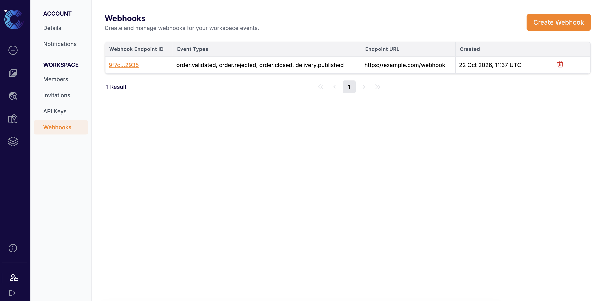
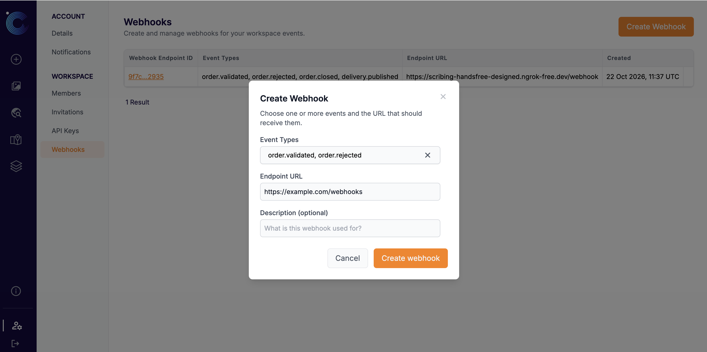
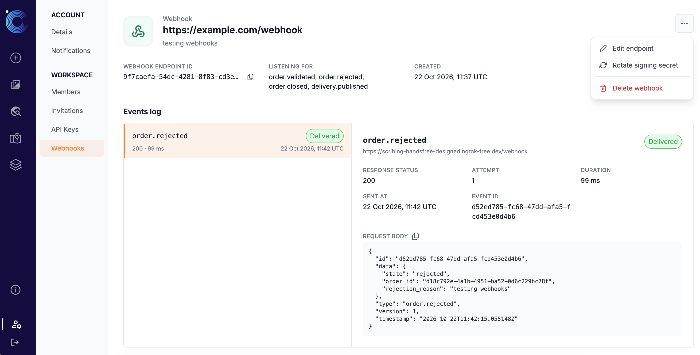
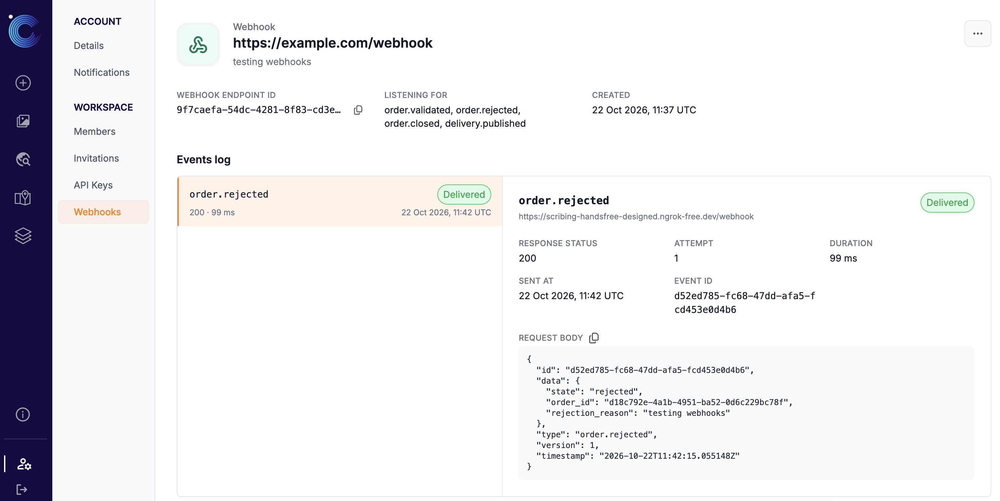
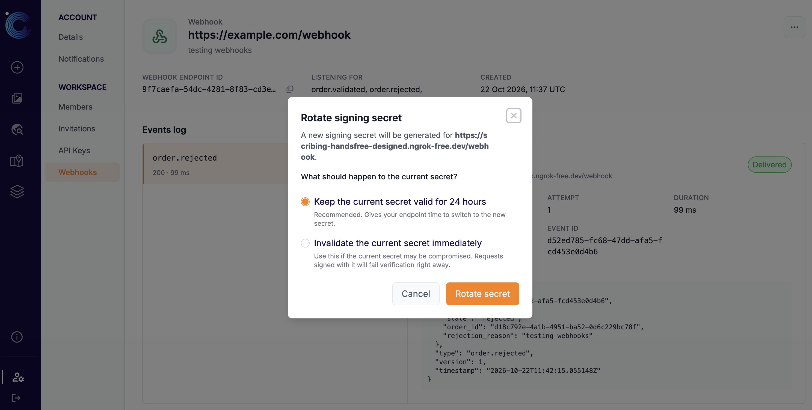

# **Notifications**

The End User Platform can keep you informed about your orders and deliveries in two ways:

* **[Email Notifications](#email-notifications)**: emails sent to you when a new delivery is available or an order's status changes.
* **[Webhooks](#webhooks)**: HTTP requests sent automatically to an endpoint you own, so your own systems can react to order and delivery events without polling our API.

---

## **Email Notifications**

Email notifications are managed per user from [Account > Notifications](https://app.constellr.com/account/notifications). You can turn order-related emails on or off for the whole workspace and choose, per order, whether to be notified about *new deliveries* and/or *status changes*.

For a full walkthrough, see the Notifications section of the [UI documentation](UI-documentation.md#notifications).

---

## **Webhooks**

Webhooks let you receive order and delivery events at a URL of your choice. Whenever a subscribed event happens in your workspace, we send an HTTP `POST` request with a JSON payload describing the event to your endpoint.

Webhooks are configured **per workspace**: every member of the workspace can see and manage them, and they receive events for all orders in that workspace. You can manage them from [Account > Workspace > Webhooks](https://app.constellr.com/account/webhooks).

### Available Event Types

| Event Type | Sent when |
|-------|-----------|
| `order.validated` | An order has been validated by constellr and accepted. |
| `order.rejected` | An order has been rejected. |
| `order.closed` | An order has been closed. |
| `delivery.published` | A new delivery is available for one of your orders. |

A single webhook can listen to one or more of these events.

### Webhooks Overview

The **Webhooks** page in the End User Platform lists all webhooks configured for the active workspace, with the following information:

* **Event Types**: The events this webhook is listening for.
* **Endpoint URL**: The URL that receives the events.
* **Created**: When the webhook was created.

{ width=80% }

### Create a Webhook

Click **Create Webhook** in the top right of the Webhooks page and fill in the form:

* **Event Types** *(required)*: Select one or more events to subscribe to.
* **Endpoint URL** *(required)*: The URL that should receive the events, for example `https://example.com/webhooks`.
* **Description** *(optional)*: A short note on what the webhook is used for, to help you and your team recognise it later.

{ width=80% }

After clicking **Create webhook**, a dialog shows the webhook's **signing secret**.

> **Important:** The signing secret is shown **only once**. Copy it and store it securely before closing the dialog. You will not be able to see it again. If you lose it, you can [rotate the signing secret](#rotate-the-signing-secret) to generate a new one.

Use the signing secret on your side to verify that incoming requests to your endpoint really come from constellr.

### Webhook Details

Click a **Webhook Endpoint ID** in the overview to open its detail page. At the top you will find the endpoint URL and description, followed by:

* **Webhook Endpoint ID**: with a copy-to-clipboard icon.
* **Listening for**: The events this webhook is subscribed to.
* **Created**: When the webhook was created.

The button in the top right gives access to [Edit endpoint](#edit-a-webhook), [Rotate signing secret](#rotate-the-signing-secret), and [Delete webhook](#delete-a-webhook).

{ width=80% }

### Events Log

The **Events log** on the webhook's detail page shows every delivery attempt made to this endpoint, newest first, in a split view:

* **Attempts list**: Each entry shows the event type, a **Delivered** (green) or **Failed** (red) badge, the HTTP response status code, how long the request took, the attempt number (when an event was retried), and when it was sent.
* **Attempt details**: Select an entry to see its full details:
    * **Response status**, **Attempt** number, **Duration** and **Sent at** time.
    * **Event ID**: The identifier of the event. Retries of the same event share the same Event ID, which you can use to de-duplicate events on your side.
    * **Error**: Shown when the request could not be completed (e.g. timeout or connection error).
    * **Response body**: What your endpoint returned, if anything.
    * **Request body**: The exact JSON payload we sent.

{ width=80% }

> **Tip:** The Events log is the first place to look when your system did not receive an event. Failed attempts show the response status and body returned by your endpoint, which usually points to the cause (e.g. authentication or validation errors on your side).

### Edit a Webhook

Choose **Edit endpoint** from the top right menu to change the **Event Types**, **Endpoint URL** or **Description** of an existing webhook. Editing a webhook does not change its signing secret.

### Rotate the Signing Secret

Choose **Rotate signing secret** to generate a new secret, for example on a regular schedule or if you lost the current one. You will be asked what should happen to the current secret:

* **Keep the current secret valid for 24 hours** *(recommended)*: Gives your endpoint time to switch to the new secret. During this period requests can be verified with either secret.
* **Invalidate the current secret immediately**: Use this if the current secret may be compromised. Requests signed with it will fail verification right away.

{ width=80% }

As when creating a webhook, the new secret is shown **only once**. Copy it and store it securely, then update your endpoint to verify requests with the new secret before the previous one expires.

### Delete a Webhook

Choose **Delete webhook** and confirm. The endpoint stops receiving events immediately. This action cannot be undone.

> **Need Help?** If you have questions about setting up webhooks, please contact your CSM or our support team at [support-csm@constellr.com](mailto:support-csm@constellr.com).
