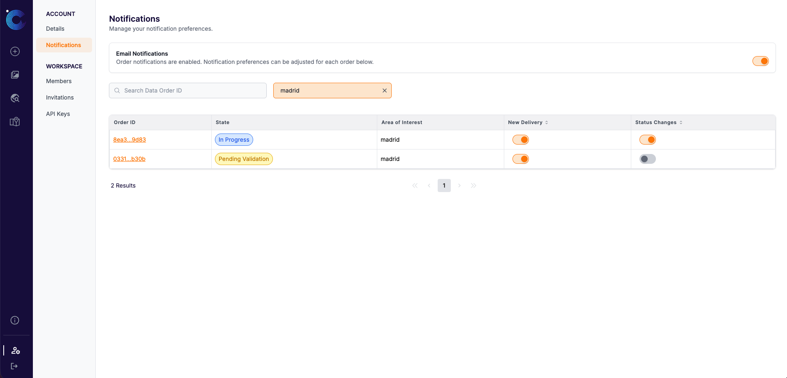

# **Email Notifications**

Email notifications keep you and your team informed about your orders without having to check the platform. They are sent to the people in your workspace who have chosen to follow an order.

If you want your **software** (rather than a person) to react to order updates, use [Webhooks](webhooks/introduction.md) instead, or in addition.

---

## When emails are sent

| Notification type | Sent when | Email subject |
| :--- | :--- | :--- |
| **New delivery** | A new delivery is available for your order | New delivery available for *&lt;AOI name&gt;* |
| **Status changes** | Your order is validated and moves to *In Progress* | Your order for *&lt;AOI name&gt;* has been validated and will be fullfilled|
| **Status changes** | Your order is rejected | Your order for *&lt;AOI name&gt;* has been rejected and will not be fullfilled|
| **Status changes** | Your order is *Closed* | Your order for *&lt;AOI name&gt;* is now closed |

---

## Who receives them

Notification preferences are **personal**. Each workspace member decides for themselves which orders they want to hear about:

* **Email Notifications (main switch)**: Turns order emails on or off for **you** in the current workspace. When it's off, you don't receive any order emails from that workspace. Your per-order preferences are kept and apply again once you switch it back on.
* **Per-order preferences**: For each order, you can turn on **Status changes** and/or **New delivery** emails independently.

Other members' preferences are not affected by yours.

---

## Managing your preferences

You can set or change your preferences in three places:

1. **When placing an order**: in the *Notification Preferences* field of the [New Order](https://app.constellr.com/new-order) form.
2. **While viewing an order**: using the bell icon in the top right of the order page in [My Data](https://app.constellr.com/my-data).
3. **On the Notifications page**: [Account > Notifications](https://app.constellr.com/account/notifications) contains the main switch and a searchable table with the preferences for all of your orders.

{ width=80% }

